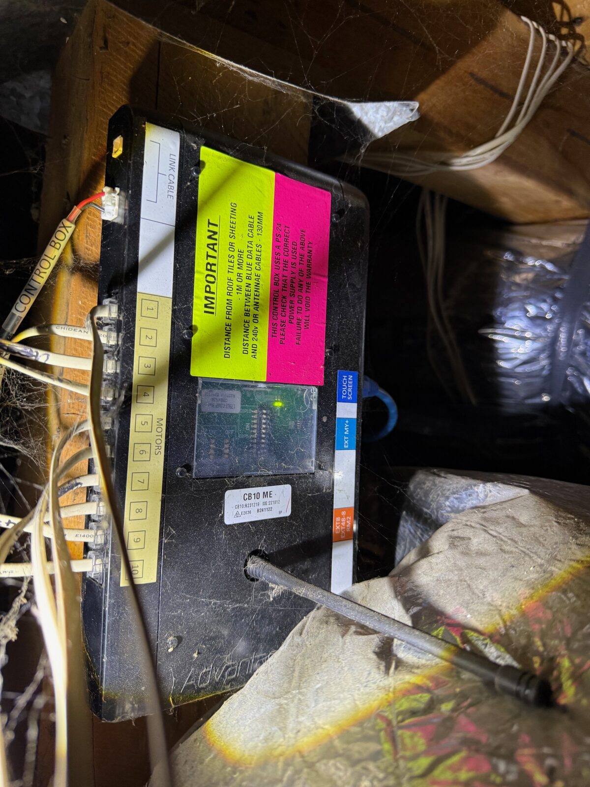
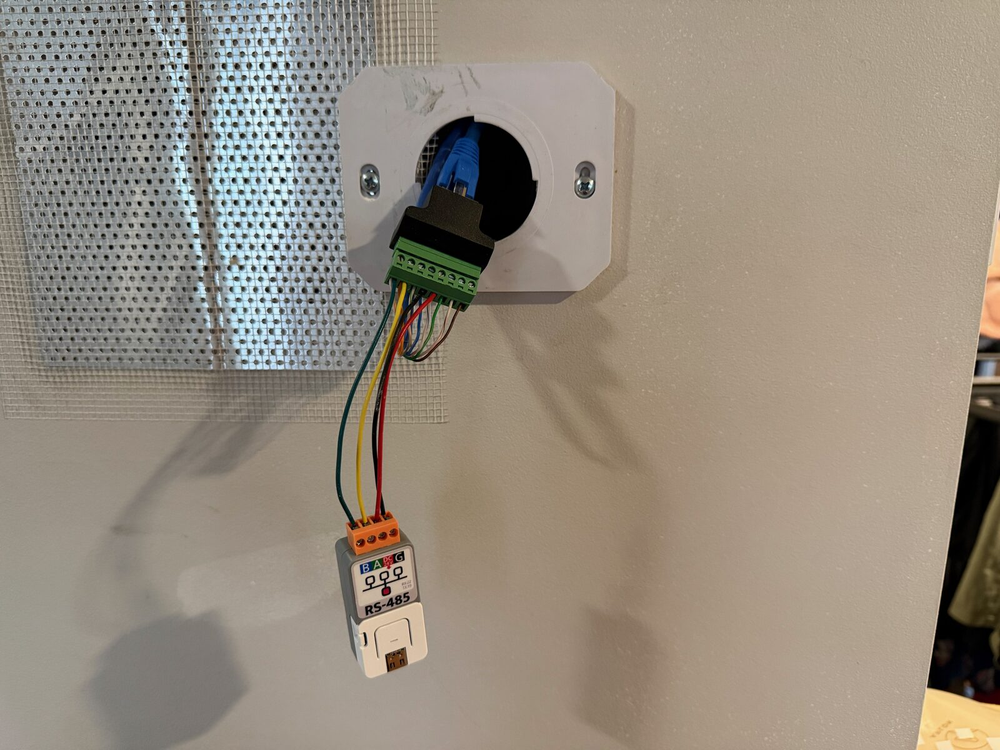
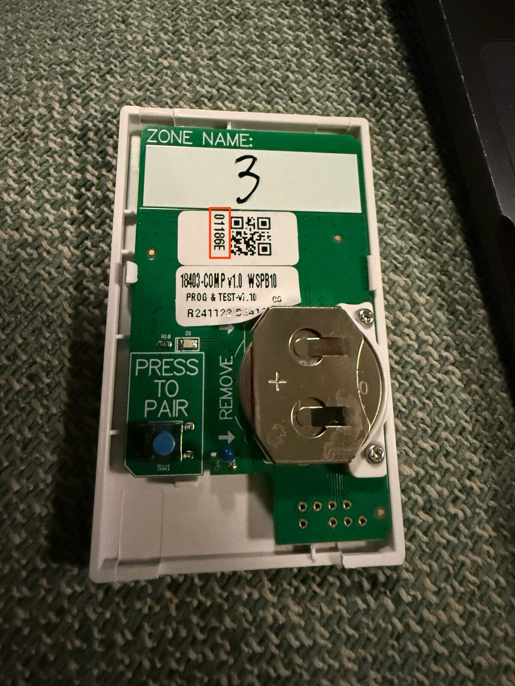

# myair-esphome

ESPHome component for replacing an Advantage Air MyAir tablet with an ESP32.

## Why

The MyPlace app sucks. The [Advantage Air integration](https://www.home-assistant.io/integrations/advantage_air/) polls the tablet, so changing a zone or mode could take up to 15 seconds to show up without optimistic updates. Annoying, and replacing the tablet with an ESP32 seemed fun.

ESPHome gives me declarative controls and pushes state updates as they arrive from the control box. The ESP runs the room controls; the box still handles the dampers and talks to the AC.

## 🔌 Hardware

An ESP32 with a hardware UART and a 3.3 V RS-485 transceiver. I'm using an ATOMS3 Lite with an A131 Atomic RS485 base, connected to the CB10's touchscreen port. The A131 handles transmit enable in hardware.

<p>
  
  
</p>

The touchscreen connection uses RS-485 at 57600 baud, 8N1:

| RJ45 pin | A131 |
| -------- | ---- |
| 1        | A    |
| 2        | B    |
| 4        | GND  |
| 5        | 24 V |

Pin 5 powers the Atom through the A131. Verify 24 V between pins 5 and 4 before connecting it.

Only one controller can drive the bus.

## ⚙️ Configuration

Example configuration for the ATOMS3 Lite and A131:

```yaml
external_components:
  - source: github://hydazz/myair-esphome@main
    components: [myair]

uart:
  id: cb_uart
  tx_pin: GPIO6
  rx_pin: GPIO5
  baud_rate: 57600
  rx_buffer_size: 2048

myair:
  uart_id: cb_uart
  zones:
    - zone: 1
      name: Living Room
      sensor_uid: "01186E"
      airflow_weight: 2

    - zone: 7
      name: Office

    - zone: 9
      name: Garage
      sensor: false
```

| Key              | Default  | Use                                                         |
| ---------------- | -------- | ----------------------------------------------------------- |
| `zone`           | Required | Physical output on the control box, 1–10                    |
| `name`           | `Zone n` | Room device name                                            |
| `sensor`         | `true`   | `false` gives manual damper control instead of a thermostat |
| `sensor_uid`     | Optional | Probe UID: six hex digits, quoted                           |
| `airflow_weight` | `1`      | Relative airflow with the damper fully open                 |

List every zone you want the ESP to manage, including any installer-configured constant zones. Unlisted zones are left alone.

Each room gets its own device. Temperature zones have a climate, temperature and damper sensor; zones without probes have a damper cover with 5% steps. Device identity follows the physical zone number, so names and YAML order can change.

`airflow_weight` is a rough duct-size estimate. Two independent feeds the size of another room's one give `2`; two outlets split from one feed still share it. A 6-inch duct has about half an 8-inch duct's area. The component applies the box's maximum damper setting separately, so leave balancing out of the weight. These estimates guide reference selection and Auto fan; they don't measure airflow or pressure.

### Optional entities

Zone entity keys accept a name, an ESPHome options mapping, or `false` to omit the entity. Use `{}` to enable an optional entity with its default name. For example:

```yaml
- zone: 1
  name: Living Room
  temperature_offset: {}
  pair_sensor: {}
  unpair_sensor: {}
  sensor_id: {}
```

| Key                  | Entity      | Created by default         |
| -------------------- | ----------- | -------------------------- |
| `climate`            | Climate     | Temperature zones          |
| `cover`              | Cover       | Zones without probes       |
| `temperature`        | Sensor      | Temperature zones          |
| `damper`             | Sensor      | Temperature zones          |
| `min_damper`         | Number      | No                         |
| `max_damper`         | Number      | No                         |
| `temperature_offset` | Number      | No; temperature zones only |
| `pair_sensor`        | Switch      | No; temperature zones only |
| `unpair_sensor`      | Button      | No; temperature zones only |
| `sensor_id`          | Text sensor | No; temperature zones only |

`min_damper` and `max_damper` change the installer's balancing limits in 5% steps. `temperature_offset` calibrates the room by −5 to +5 °C and adjusts the setpoint sent to the box. A filter on the temperature entity only changes its published reading.

Hiding an entity leaves the zone under control. The main climate can also be customised through `myair.climate`.

## Control

The main climate sets mode and fan speed. Each room has a heat-to/cool-to range, in whole degrees with at least 2 °C between them. Main target changes apply to every temperature room, including rooms that are off; rooms can then be adjusted individually. Changing mode preserves those ranges.

The AC regulates against one **reference zone**, whose damper stays at its maximum. The ESP picks the room furthest past its target. Once that room is satisfied, it can move the reference to another room still needing air, with 10 minutes between moves. Turning the reference room off triggers a handover immediately. Other rooms use the box's proportional damper loop; the ESP can trim their setpoints by 1 °C to help rooms falling behind.

In **Auto**, room demand decides heating or cooling. Changeover needs 15 minutes without demand on the current side and a room at least 1 °C past the opposite target. **Auto fan** follows demand and estimated open airflow, stepping up at most every 10 minutes and down every 20. It drops sooner if too few dampers are open. Manually selected fan speeds stay put.

Heavily throttled rooms, at or below 15% of the largest zone's estimated airflow, can't become the reference or run the AC alone. They get air while another zone runs it. Constant zones open as needed to make up the box's minimum total damper opening. The thresholds are starting values from my house; [controller.cpp](components/myair/controller.cpp) has the details.

Turning the last eligible room or airflow zone off requests AC Off. Shutdown leaves the dampers and reference alone because the indoor fan may still be running. With only airflow zones on, the AC uses its own thermostat and saved setpoint; Auto becomes the AC's native Auto mode.

First boot starts with the AC and all configured zones off. Balancing limits and constant-zone assignments stay in the control box.

Cooling, zone control and reference changes are running here. Heating, sensorless zones, constant zones and defrost still need testing with the tablet removed.

### Power feedback

No compressor status flag has been identified on the bus. Without a power meter, the climate action follows the confirmed AC mode. An enabled system can therefore show Cooling while the compressor is idle.

An optional sensor in watts adds Idle detection:

```yaml
sensor:
  - platform: homeassistant
    id: ac_power
    entity_id: sensor.ac_power
    internal: true

myair:
  uart_id: cb_uart
  power_feedback:
    sensor: ac_power
    idle_below: 75 W
  # zones: ...
```

Choose `idle_below` above your standby draw. While enabled, readings below it report Idle; readings at or above it use the confirmed mode. Confirmed Off always reports Off. Invalid or unavailable readings fall back to the mode; no new reading leaves the last value in use. Power feedback only affects the displayed activity.

Room actions follow the system action and damper position. In heating or cooling, the box's 5% idle position reports Idle; an open reference room can still show Heating or Cooling after reaching its target. Damper position is a command, not measured heat delivery.

## Temperature sensors



Set `sensor_uid` to the ID marked in red. If the sticker is missing, enable `pair_sensor` and `sensor_id` on the zone to read it through pairing:

1. Turn on **Pair Sensor**.
2. Hold the probe's button until the LED flashes.
3. **Sensor UID** shows the assignment when the box receives the probe.

Pairing stops on success, failure or after 60 seconds. Pairing a probe to another zone moves it; **Unpair Sensor** removes it. Saved pairing takes precedence over YAML and is sent to the box on reconnect.

The box repeats cached temperatures between RF reports. After removing a probe battery, it kept the last reading for about 10 minutes before marking the sensor absent. The component then discards that temperature. **Sensor Report Counter** exposes the probe's 8-bit counter: it advances even if temperature hasn't changed and wraps at 255.

**Low Battery** follows the box's “Check Battery” flag, which can also mean a missing probe. **Sensor Error Flags** is a bitmask: `1` for a temperature sensor clash, `2` for Check Battery, `4` for a motion sensor clash.

## Diagnostics

**Reference Zone**, **AC Mode** and **AC Fan** show what the box reports. The climate retains the requested mode and fan, so Auto can appear alongside Cool and Low. **AC Error** exposes equipment errors; **Activity Feedback** shows Power, Unavailable or Not configured.

**Connected** tracks communication with the box. Check it if climate values look stuck: Home Assistant 2026.11.1 retains climate values when ESPHome marks their state missing.

**Sensor Error Flags**, **Sensor Report Counter** and **Unconfirmed Write Batches** are disabled by default in Home Assistant. The write counter counts resyncs that discarded pending writes this boot; the ESP log lists those writes.

## 🧑‍💻 Development

```sh
mise install
mise run deps
mise run fmt-check
mise run lint
mise run test
mise run build
```

[tests/firmware.yaml](tests/firmware.yaml) is the build config. Host tests cover the protocol and controller without hardware.

## 📄 License

Licensed under the [Apache License 2.0](LICENSE).

## 🙏 Acknowledgments

- [cb-daemon](https://github.com/retsimx/cb-daemon) and [aa_interop](https://github.com/gundy/aa_interop) for the protocol work.
